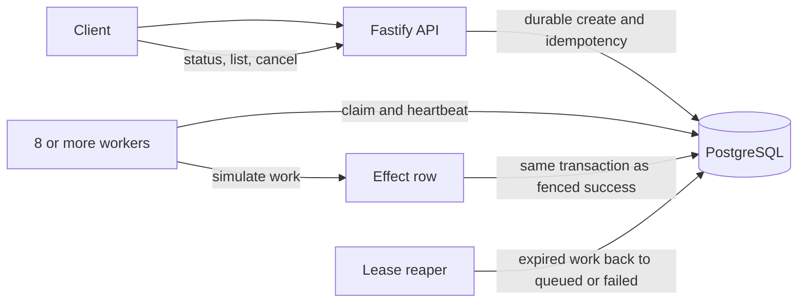

# Design: PostgreSQL Training-Job Queue

## Goal

Accept jobs durably, run them across at least four workers, recover after worker death, and prove the system's behavior with failures rather than happy-path checks. Training is simulated by inserting a countable row.

## Architecture

PostgreSQL is both the job store and the queue. The API validates requests and writes a job plus its idempotency key in one transaction. It acknowledges the request only after commit. Workers poll PostgreSQL and claim queued rows with `FOR UPDATE SKIP LOCKED`; each claim records owner, attempt, expiry, and a fencing number. A lease reaper returns expired work to the queue or fails it after the retry limit. PostgreSQL time is the only lease clock.

Completion updates a job only if it is still running under the same owner and fence. The effect row has a unique job ID and commits in that same transaction. Execution can happen more than once; a successful job has exactly one committed database effect. This guarantee does not cover external services.

A queued job can be cancelled directly. For a running job, cancellation and completion compete through conditional database updates. If cancellation wins, it invalidates the worker fence and no effect commits. If completion wins, cancellation reports that the job is already terminal.

## Why PostgreSQL only

The required job state, retries, idempotency, lease, and test effect need durable transactions and constraints. One database can atomically commit a job or effect with its state. Redis and BullMQ are excluded because this assignment needs no cache or separate broker; buffering an acknowledged job before PostgreSQL commit would create a loss window. PostgreSQL `LISTEN/NOTIFY` may be considered later only as a wake-up hint, with polling retained as recovery.

## Pagination and performance

Use keyset pagination over `(created_at, id)` for a stable result set. The API does not promise a snapshot across separate page requests while concurrent inserts happen. Do not serialize all inserts through one timestamp row to create that stronger guarantee; it is outside the supplied task and may increase latency.

The latest load run missed its 100 RPS performance/drain checks. Diagnose the timestamp-row lock and outbox relay separately before claiming either is the cause. A final p99 limit must be selected before the run; 200 ms is a proposed project target, not a target in the supplied assessment text.

## Verification and limits

Use unit and real-PostgreSQL integration tests, deterministic races, the 10,000-job/eight-worker kill harness, mutation of the fence, worker clock skew, and a 100 RPS load run. Retain all raw output, including failures. A single-host harness cannot prove behavior under database/disk loss, network partitions, all possible schedules, or duplicate external effects.
