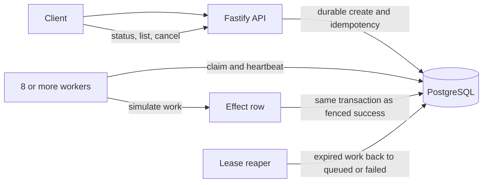

# Design: PostgreSQL Training-Job Queue

## Goal

Accept jobs durably, run them across at least four workers, recover after worker death, and prove the system's behavior with failures rather than happy-path checks. Training is simulated by inserting a countable row.

## Architecture

PostgreSQL is both the job store and the queue. The API validates requests and writes a job plus its idempotency key in one transaction. It acknowledges the request only after commit. Workers poll PostgreSQL and claim queued rows with `FOR UPDATE SKIP LOCKED`; each claim records owner, attempt, expiry, and a fencing number. A lease reaper returns expired work to the queue or fails it after the retry limit. PostgreSQL time is the only lease clock.

Completion updates a job only if it is still running under the same owner and fence. The effect row has a unique job ID and commits in that same transaction. Execution can happen more than once; a successful job has exactly one committed database effect. This guarantee does not cover external services.

A queued job can be cancelled directly. For a running job, cancellation and completion compete through conditional database updates. If cancellation wins, it invalidates the worker fence and no effect commits. If completion wins, cancellation reports that the job is already terminal.

## Why PostgreSQL only

The required job state, retries, idempotency, lease, and test effect need durable transactions and constraints. One database can atomically commit a job or effect with its state. Redis and BullMQ are excluded because this assignment needs no cache or separate broker; buffering an acknowledged job before PostgreSQL commit would create a loss window. PostgreSQL `LISTEN/NOTIFY` may be considered later only as a wake-up hint, with polling retained as recovery.

## Pagination and performance

Use keyset pagination over `(created_at, id)` for a stable result set. Separate
page requests do not share a snapshot while concurrent inserts happen. A late
commit can sort behind an already-issued cursor; clients restart at page one for
a fresh view. This is the API's documented live-list contract. The assignment
requires pagination but does not require a multi-request snapshot.

The Phase 7 load run completed 60,000 requests at 100.00 RPS with p50 8.56 ms,
p99 21.57 ms, no errors, and an empty queue after a 0.10 second drain. This meets
our project p99 target of 200 ms; the assessment itself sets no latency limit.
The earlier PostgreSQL/Redis/outbox run had p99 1,027 ms and 60,049 pending
outbox events after 121.7 seconds. That run showed a slow end-to-end design but
did not prove Redis alone caused the regression. Phase 7 removes the relay/outbox
path and the global creation lock.

## Verification and limits

All ten 10,000-job/eight-worker chaos seeds passed, along with the fence-removal
mutation check, worker clock-skew probe, READ COMMITTED isolation probe, unit and
PostgreSQL integration suites, and CI build checks. The verdict is **SHIP at 100
RPS for the tested workload**. Retain all raw output, including failed runs. A
single-host harness cannot prove behavior under database/disk loss, network
partitions, all possible schedules, or duplicate external effects.
