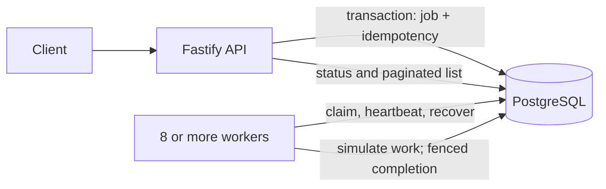

# Product Requirements: Training-Job Queue

**Status:** Rebased on the supplied take-home task. This document replaces the earlier draft requirements.
**Goal:** Answer with evidence whether a multi-worker job queue survives production-like failures.

## 1. Scope

Build a small service that accepts training-job requests, stores them durably, runs them with multiple workers, and exposes their state. Training is simulated with a countable database side effect. Correct failure behavior matters more than a green happy path.

**In scope:** create with an idempotency key, get status, list with pagination, cancel, at least four workers (target eight), retries after worker death, stale-worker protection, a reproducible chaos harness, silent-failure checks, 100 requests/second evidence, and an honest ship verdict.

**Out of scope:** real model training, UI, authentication, multi-region deployment, Redis-backed job intake, BullMQ, cache, event delivery, and deployment automation. Add those only if a requirement appears that needs them.

## 2. Core behavior

States are `queued`, `running`, `succeeded`, `failed`, and `cancelled`.

- A successful create commits a job and its idempotency key before acknowledging it.
- Repeating the same key and same request returns the original job. Reusing the key with a different request returns a conflict.
- `GET /jobs/:id` returns the current state and attempt information. Unknown IDs return not found.
- `GET /jobs?limit&cursor` returns a page in stable `(created_at, id)` order. Cursors are opaque. Pagination is tested for a fixed result set; this API does not promise a multi-request database snapshot while new jobs are being committed.
- `POST /jobs/:id/cancel` cancels queued jobs. For running jobs, cancellation and completion race through conditional database updates: exactly one transition wins. A successful cancellation prevents the worker from committing its effect.
- Workers recover jobs whose database-timed lease expired. Exhausted retries end in `failed`.

## 3. Architecture and guarantees

**Storage choice: PostgreSQL.** It is the sole durable authority for jobs, idempotency, leases, attempts, and effects. A job is acknowledged only after its transaction commits. Workers claim jobs from PostgreSQL using row locks and `SKIP LOCKED`; no separate broker is needed for this scope.

A worker claim records owner, lease expiry, attempt, and a monotonically increasing fence value. The reaper uses PostgreSQL time to find expired leases. Completion checks the current owner, state, and fence in the same transaction that records the effect and success state.

**Guarantee:** execution is at least once; a database effect for a successful job is committed exactly once. Retries and worker crashes can repeat execution. This does not promise exactly-once behavior for external services or files; the required side effect stays in PostgreSQL so its count is provable.

PostgreSQL's `LISTEN/NOTIFY` may be used only as a wake-up hint if measurements justify it; workers must continue polling because notifications are not the durable queue. Redis and BullMQ are not used in this scope. A future Redis cache or event consumer must be derived from committed database state, never used to acknowledge an uncommitted job.

## 4. API and data rules

- `POST /jobs` requires `Idempotency-Key`; validate the request before opening a transaction.
- `GET /jobs/:id`, `GET /jobs?limit&cursor`, and `POST /jobs/:id/cancel` expose only persisted state.
- Store jobs, unique idempotency keys plus request hashes, execution attempts, and one `job_effects` row per successful job.
- Enforce valid state changes and one effect per job with database conditions and constraints.
- Use database time for leases. Never trust worker wall clocks for lease validity.
- Do not buffer accepted jobs in Redis or wait to batch their writes: a success response means PostgreSQL has committed the job.

## 5. Failure requirements

The system must show what happens on worker `SIGKILL`, a worker paused past its lease and resumed, repeated create requests, cancellation racing completion, dead-worker recovery, and supported transaction isolation. No acknowledged job may disappear; after recovery no job may remain `running`; no job may have more than one committed effect; final state and effect count must agree.

The harness cannot prove behavior under every schedule, PostgreSQL/disk loss, network partition, production-scale data, or duplication of external side effects. State those limits with the verdict.

## 6. Verification and release gate

- Unit and real-PostgreSQL integration tests cover API validation, idempotency, pagination, claims, fencing, cancellation, leases, retries, and effect counts.
- Chaos: 10,000 jobs, eight workers, a randomly selected worker killed with `kill -9` about every two seconds, with repeated same-key POSTs and cancellations in parallel. Run at least 10 seeded runs; retain raw output and failed runs unchanged.
- Silent-failure checks explicitly cover double claims, zombie writes, cancel/complete races, request retries, configured isolation, and worker clock skew.
- Load: 100 requests/second for 10 minutes. Record request outcomes, p50/p95/p99, queue depth, stuck jobs, and drain time. Require all work to settle and invariants to hold.
- The supplied task sets no latency threshold. Use **p99 under 200 ms as a proposed project SLO**, clearly labeled as our chosen target, unless the reviewer chooses another threshold before the final run.
- Verdict is **SHIP** only if invariants pass, the queue drains, load outcomes meet the predeclared latency target, and no silent failure remains unexplained. Otherwise state **DON'T SHIP** and the first fix.

## 7. Deliverables

Repository, one-page `DESIGN.md`, chaos harness and raw output for every run (including failures), a paragraph on surprises and remaining concerns, and `AI_USAGE.md` listing tools, accepted suggestions, and what was verified, changed, or redone. Prepare an email reply to `team@trysoup.dev`; do not claim it was sent unless it is actually sent. Do not prewrite live-discussion answers.
